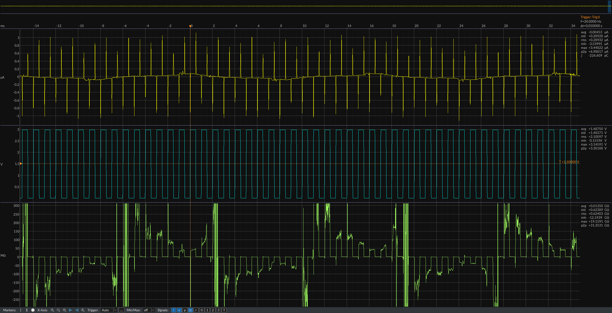

<!--
# SPDX-FileCopyrightText: Copyright 2018-2025 Jetperch LLC
# SPDX-License-Identifier: Apache-2.0
#
# Licensed under the Apache License, Version 2.0 (the "License");
# you may not use this file except in compliance with the License.
# You may obtain a copy of the License at
#
#     http://www.apache.org/licenses/LICENSE-2.0
#
# Unless required by applicable law or agreed to in writing, software
# distributed under the License is distributed on an "AS IS" BASIS,
# WITHOUT WARRANTIES OR CONDITIONS OF ANY KIND, either express or implied.
# See the License for the specific language governing permissions and
# limitations under the License.
-->

# 

## About this fork

This repository is a personal fork of
[jetperch/pyjoulescope_ui](https://github.com/jetperch/pyjoulescope_ui).
It adds oscilloscope-style features to the Oscilloscope view's Waveform
widget.  Jetperch does not provide or support these features, and the
official Joulescope UI releases do not include them.  To use them,
run the UI from this repository's source, as described in
[Developer Howto](#developer-howto).  The rest of this README is the
original upstream README.

### Oscilloscope trigger

The trigger holds repeating waveforms steady while streaming, like a
standard oscilloscope.  It places a level crossing of the trigger source
at the trigger position on the time axis, and the time axis displays the
time relative to the trigger.

* Select the mode in the control bar **Trigger** drop-down:
  * **Auto** displays each trigger, and follows the newest data when no
    trigger occurs.
  * **Normal** displays each trigger, and holds the last trigger when no
    trigger occurs.
  * **Single** displays the next trigger, then holds it.  Press **Arm** to
    capture another.
* Click **…** next to the mode to configure the source (current, voltage,
  power, current range, or a general purpose or trigger input), the rising,
  falling, or either edge, the level, the position, the holdoff, and the
  noise rejection.  Enter the level with an optional SI prefix and units,
  such as `150 mA` or `-20u`, or click **Center** for the middle of the
  displayed signal.
* Drag the **T** markers to change the level and the position.  Drag the
  trace left or right to move the trigger position.
* Right-click a plot and select **Trigger here** to trigger on that plot at
  the clicked level.
* The holdoff ignores triggers for a duration after each trigger.  Set the
  holdoff slightly longer than a burst to trigger on the first edge of each
  burst.

The trigger examines every raw sample, not just the displayed points, and
interpolates the crossing between samples, so a locked waveform does not
jitter.  The trigger operates on live streaming data.  When streaming
stops, the display holds the last trigger.

### Markers that follow the trigger

Markers (cursors) placed while the trigger is on keep their time relative
to the trigger as the display refreshes.  Dual markers measure the time,
frequency, and statistics, such as the peak values, between two points of
the triggered waveform.  Enable **Show frequency** in the Waveform settings
to display the frequency.  Right-click a marker and select
**Follow trigger** to change an existing marker.  The markers hold their
position when the trigger is off, and follow again when it returns.

### Resistance plot

Click the **Ω** signal button in the control bar to show the resistance,
R = V / I.  The Joulescope streams current, voltage, and power, so the UI
computes the resistance from the displayed voltage and current.

* When zoomed in to individual samples, each point is the instantaneous
  resistance.
* When zoomed out, each point is the average voltage divided by the average
  current.
* Dual markers display the average resistance over the marker interval.
* When the current is near zero, the resistance becomes very large and
  changes sign with the current noise.  Division by zero displays as
  missing data.
* The summary waveform, the trigger, the analysis tools, and JLS file
  export use the voltage and current signals, not the resistance.

See the [Changelog](CHANGELOG.md) 1.9.0 section for the complete list of
changes in this fork.

---

Welcome to the Joulescope™ User Interface software repo!
Joulescope is an affordable, precision energy
analyzer that enables you to build better products.
Joulescope™ accurately and simultaneously measures the voltage and current
supplied to your target device, and it then computes power and energy.
For more information on Joulescope, see
[www.joulescope.com](https://www.joulescope.com).

This repository contains the Joulescope graphical User Interface (UI).
The UI runs on a host computer and communicates with the Joulescope device
over USB.  The application source code is available at
https://github.com/jetperch/pyjoulescope_ui.  

The software is highly configurable.  Here is the Multimeter view on Windows 11:

And here is the Oscilloscope view on Windows 11:

For more information, see:

* [Tips](docs/tips.md): for using the UI.
* [Translations and locale](docs/locale.md)
* [Plugins](docs/plugin.md): Using and developing UI plugins.
* [TCP Server](docs/tcp_server.md)
* [Changelog](CHANGELOG.md): list of changes by release
* [Future features](docs/features_future.md)
* [Contributing](CONTRIBUTING.md)
* [Code of Conduct](CODE_OF_CONDUCT.md)
* [Developer notes](docs/dev.md)
* [PubSub](docs/pubsub.md)

## Quick start using official distribution

We provide official distributions for Windows, macOS and Ubuntu 22.04LTS.

Visit the main [download](https://www.joulescope.com/download) 
page for the latest stable build.

You can download the latest and previous alpha, beta, and stable builds
[here](https://download.joulescope.com/joulescope_install/index_v2.html).

Linux users can alternatively install the [Flatpak](https://flatpak.org/)
bundle.  See [docs/flatpak.md](docs/flatpak.md), which also covers the
host udev rules required for USB device access.

## Run as python package

The Joulescope UI is a python package which you can install for pypi or
run directly from source.

### Install Python

The Joulescope User Interface requires Python 3.9 or newer.
We recommend Python 3.11.
Install [Python 3.9+](https://www.python.org/) on your system and then verify
your python version at the terminal or command line:

    > python -VV
    Python 3.11.4 (tags/v3.11.4:d2340ef, Jun  7 2023, 05:45:37) [MSC v.1934 64 bit (AMD64)]

Ensure that you have Python 3.9 or newer and 64-bit.
For macOS, you can also use
[Homebrew](https://docs.brew.sh/Installation)
to [install python](https://docs.brew.sh/Homebrew-and-Python).

### Configure virtualenv [optional]

Although not required, using
[virtualenv](https://virtualenv.pypa.io/en/latest/)
avoids dependency conflicts, especially if you use your python installation for
other programs.  Using virtualenv ensures that
the Joulescope software has the right dependencies without changing the rest
of your system.

#### For Windows:

Install virtualenv and create a new virtual environment:

    python -v venv c:\venv\joulescope

Activate the virtual environment whenever you start a new terminal:

    c:\venv\joulescope\Scripts\activate

#### For POSIX including (Linux, macOS):

Install virtualenv and create a new virtual environment:

    python -m venv ~/venv/joulescope

Activate the virtual environment whenever you start a new terminal:

    . ~/venv/joulescope/bin/activate

### Install using pypi

Installation from pypi is easy:

    python -m pip install -U --upgrade-strategy=eager joulescope_ui
    
If you just want to run the latest released version of the UI.

For Linux, you need to perform additional steps.  Here are steps for
Ubuntu:

    sudo apt install libudev-dev libxcb-cursor0
    wget https://raw.githubusercontent.com/jetperch/joulescope_driver/main/99-joulescope.rules
    sudo cp 99-joulescope.rules /etc/udev/rules.d/
    sudo udevadm control --reload-rules

If you receive the error:
`Could not load the Qt platform plugin "xcb" in "" even though it was found`,
you need to install additional dependencies.  First identify the 
missing dependencies:

    export QT_DEBUG_PLUGINS=1
    python3 -m joulescope_ui

Then install them using apt or your distribution's package manager.
The Joulescope UI uses Qt6, and you can find the Qt6 dependencies
[here](https://doc.qt.io/qt-6/linux-requirements.html).

### Run

Whenever you want to run the Joulescope UI:

    python -m joulescope_ui

Depending upon your system, you may need to replace "python" 
with "python3" or the full path to your python executable.

The joulescope package also contains an executable, so you can often type:

    joulescope ui

## Developer Howto

Clone and configure the Joulescope UI from the terminal or command line:

    git clone https://github.com/jetperch/pyjoulescope_ui.git
    cd pyjoulescope_ui
    python -m pip install -U --upgrade-strategy eager -r requirements.txt

Build the QT resources:

    python setup.py sdist

As long as the current directory is the source directory, you can run:

    python -m joulescope_ui

If you want to run from another directory, you will need to add the source
to your PYTHONPATH environment variable.  

Windows using command prompt:

    set PYTHONPATH={C:\path\to\repos}\pyjoulescope_ui

Windows using PowerShell:

    $env:PYTHONPATH = "{C:\path\to\repos}\pyjoulescope_ui"

POSIX shells (most Linux, macOS with homebrew):

    export PYTHONPATH={path/to/repos}/pyjoulescope_ui

To also distribute the UI on macOS, you need to install XCode and then
configure node.  If using homebrew:

    brew install node
    npm install

You will also need to install the signing certificate using
Applications/Utilities/Keychain Access.

If you also want to simultaneously develop the Joulescope UI and the
Joulescope driver, you can include the joulescope_driver in 
your PYTHONPATH and build in place:

    pip3 uninstall joulescope
    cd {path/to/repos}
    git clone https://github.com/jetperch/joulescope_driver.git
    cd joulescope_driver
    pip3 install -U -r requirements.txt
    python setup.py build_ext --inplace && python -m unittest
    git clone https://github.com/jetperch/pyjoulescope.git
    cd pyjoulescope
    pip3 install -U -r requirements.txt    
    python setup.py build_ext --inplace && python -m unittest

You should then modify your python path to find both the UI and driver
source paths. On Windows:

    set PYTHONPATH={C:\path\to\repos}\joulescope_driver;C:\path\to\repos}\pyjoulescope;{C:\path\to\repos}\pyjoulescope_ui

and on POSIX (Linux, Mac OS X with homebrew):

    export PYTHONPATH={path/to/repos}/pyjoulescope:{path/to/repos}/pyjoulescope_ui

## License

All pyjoulescope_ui code is released under the permissive Apache 2.0 license.
See the [License File](LICENSE.txt) for details.
